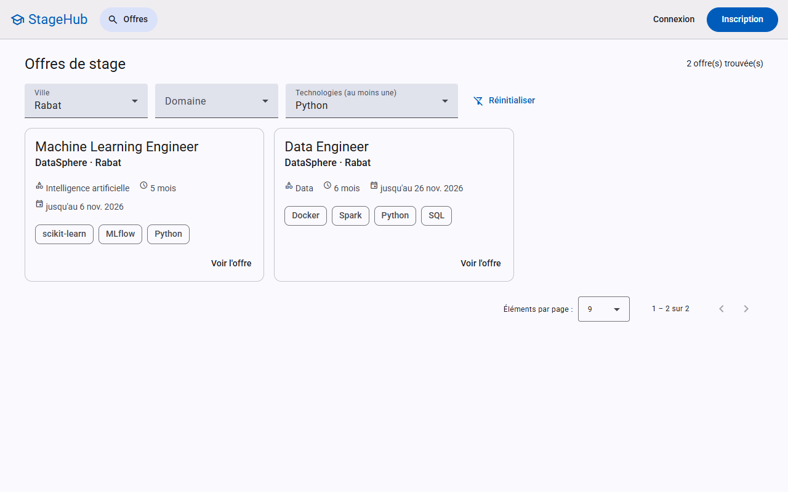
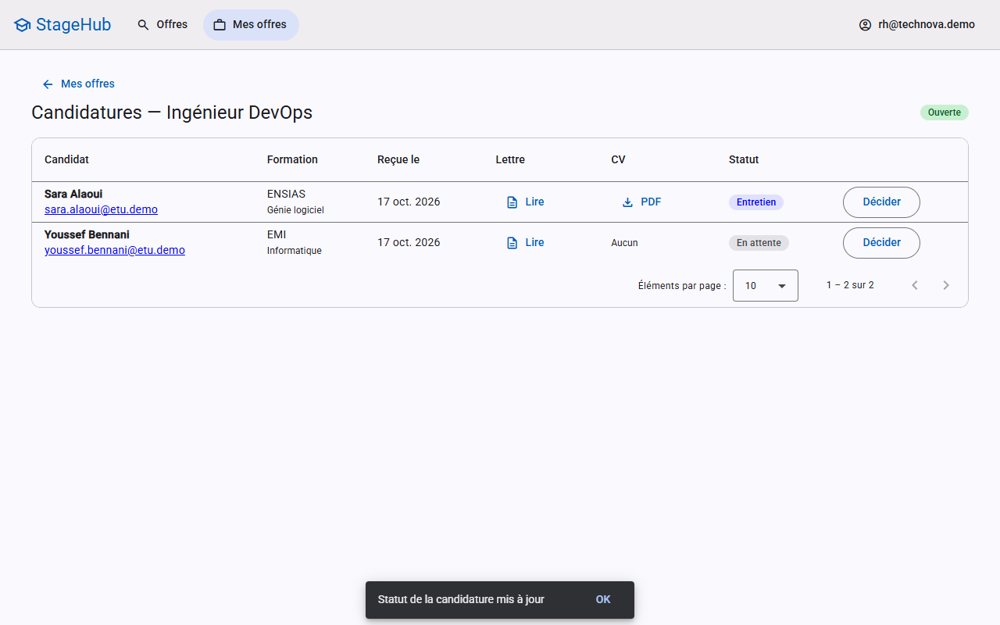
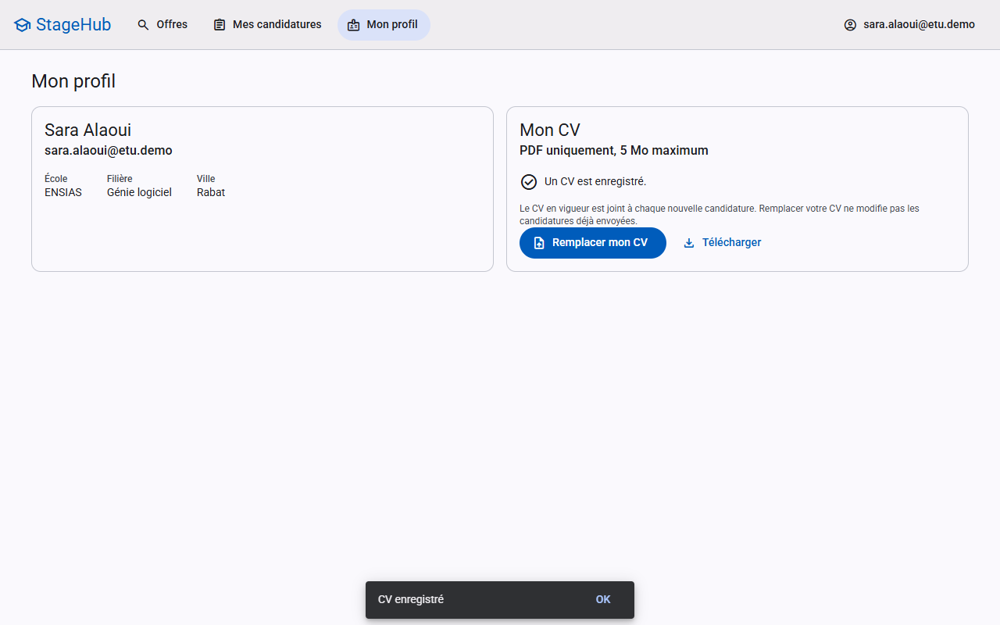
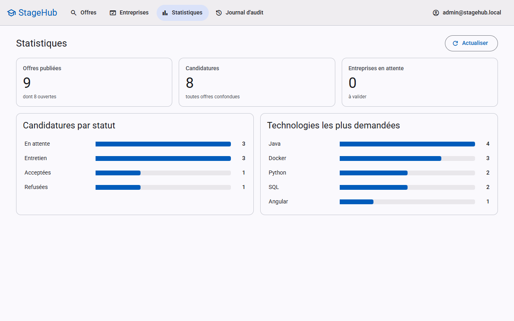
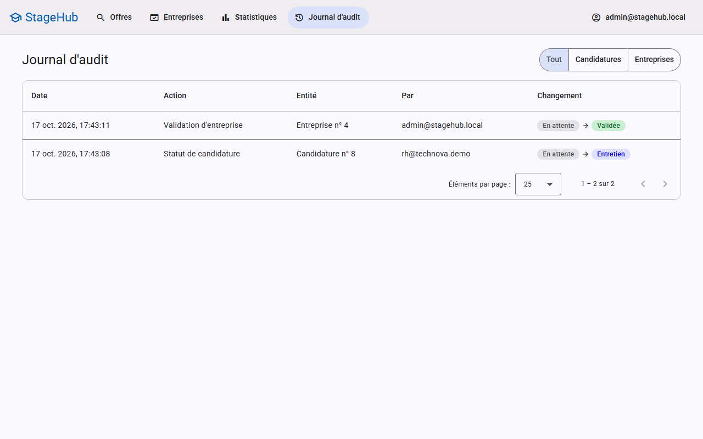
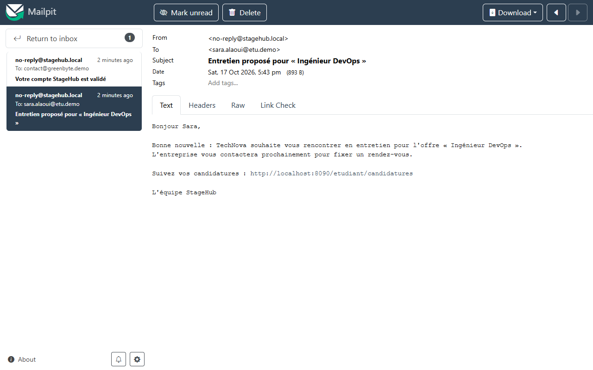
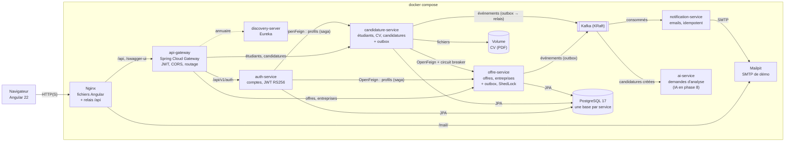
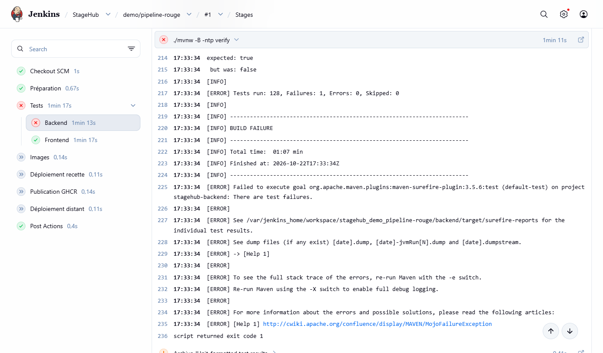
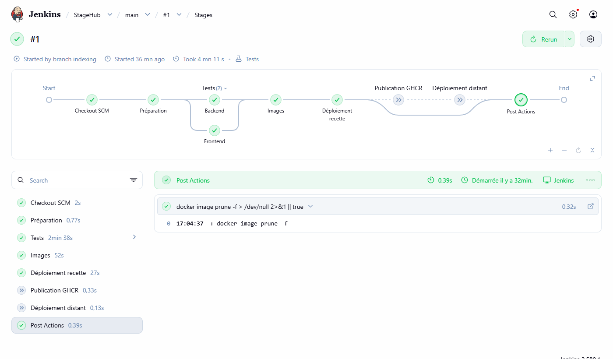
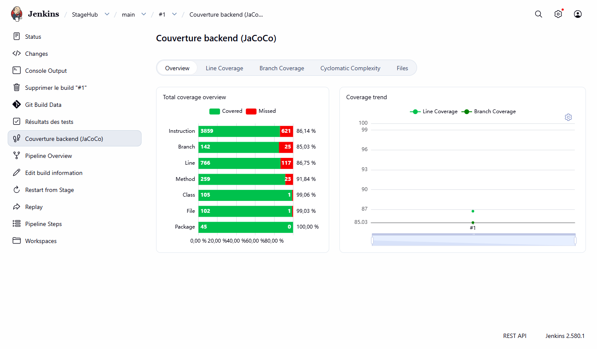

# StageHub

**Plateforme de gestion des stages PFE** : les entreprises publient leurs offres, les étudiants postulent avec leur CV,
l'administrateur valide les entreprises et suit l'activité.

Projet portfolio full stack : **Spring Boot 4 · Java 21 · Angular 22 · PostgreSQL · Docker**, en **microservices**
(Spring Cloud Gateway, Eureka, OpenFeign, Kafka) avec sécurité JWT, tests automatisés (couverture contrôlée par
JaCoCo), audit par AOP, emails par événements et tâches planifiées.

> Le projet a commencé en monolithe Spring Boot (phases 1 à 6), découpé ensuite service par service. Le monolithe
> complet reste consultable au tag [`v1.0-monolithe`](https://github.com/zakaech/stagehub/tree/v1.0-monolithe).



---

## Sommaire

- [Fonctionnalités](#fonctionnalités)
- [Démarrage en une commande](#démarrage-en-une-commande)
- [Comptes de démo](#comptes-de-démo)
- [Captures d'écran](#captures-décran)
- [Architecture](#architecture)
- [Stack technique](#stack-technique)
- [Développement](#développement)
- [Tests et qualité](#tests-et-qualité)
- [Intégration continue (Jenkins)](#intégration-continue-jenkins)
- [Déploiement](#déploiement)
- [Structure du dépôt](#structure-du-dépôt)

---

## Fonctionnalités

**Étudiant**
- Inscription, connexion
- Recherche d'offres : filtres ville, domaine, technologies (au moins une), pagination ; filtres et page dans l'URL
  (bouton retour, liens partageables)
- Dépôt du CV (PDF vérifié par son contenu, 5 Mo maximum), candidature avec lettre de motivation
- Suivi du statut de ses candidatures, notification par email à chaque changement

**Entreprise**
- Inscription (compte en attente de validation par l'administrateur), email à la validation ou au refus
- Publication, modification, fermeture et réouverture de ses offres
- Candidatures reçues : profil, lettre, **CV tel qu'il était au moment de la candidature**
- Décision (entretien, acceptée, refusée) selon une machine à états ; seules les transitions valides sont proposées

**Administrateur**
- Validation ou refus des comptes entreprise
- Statistiques : offres, candidatures par statut, technologies les plus demandées
- Journal d'audit : qui a changé quel statut, quand, de quelle valeur à quelle valeur

**Automatique**
- Chaque nuit à 00:05 (heure de Casablanca), fermeture des offres dont la date limite est passée

---

## Démarrage en une commande

Prérequis : **Docker** (Docker Desktop sous Windows/macOS). Rien d'autre : Java, Node et PostgreSQL tournent dans des
conteneurs.

```bash
cp .env.example .env && docker compose up -d --build
```

Sous Windows (invite de commandes `cmd`) :

```bat
copy .env.example .env && docker compose up -d --build
```

Le premier lancement télécharge les images et construit l'application (plusieurs minutes). Ensuite :

| | Adresse |
|---|---|
| **Application** | http://localhost:8090 |
| Emails envoyés (Mailpit) | http://localhost:8090/mail/ |
| Documentation de l'API (Swagger, une page par service) | http://localhost:8090/swagger-ui.html |
| Annuaire des services (Eureka) | http://localhost:8761 |

`docker compose ps` doit montrer tous les services `healthy` ; le programme `demo-seeder` crée ensuite les données
de démo puis s'arrête (`docker compose logs demo-seeder`). Arrêt : `docker compose down` (les données sont conservées
dans des volumes).

> Les valeurs de `.env.example` conviennent pour un essai local (la clé de signature des JWT est alors générée au
> premier démarrage). Sur un serveur, changer **tous** les mots de passe et fournir la clé `JWT_PRIVATE_KEY`
> (voir [docs/DEPLOIEMENT.md](docs/DEPLOIEMENT.md)).

---

## Comptes de démo

Créés au premier démarrage par le programme `demo-seeder` (profil compose `demo`), **à travers l'API** comme le ferait
un utilisateur : inscriptions, validation par l'admin, offres, candidatures. Mot de passe commun : **`demo1234`**
(variable `DEMO_PASSWORD`).

| Rôle | Email | Situation |
|---|---|---|
| Étudiant | `sara.alaoui@etu.demo` | 2 candidatures |
| Étudiant | `youssef.bennani@etu.demo` | 3 candidatures, dont une acceptée |
| Étudiant | `imane.tazi@etu.demo` | 2 candidatures |
| Entreprise | `rh@technova.demo` | Validée, 3 offres |
| Entreprise | `stages@datasphere.demo` | Validée, 3 offres (dont une fermée) |
| Entreprise | `contact@greenbyte.demo` | **En attente** de validation |
| Admin | `ADMIN_EMAIL` / `ADMIN_PASSWORD` du `.env` | `admin@stagehub.local` / `change-me-admin` avec l'exemple |

Tous les emails (adresses fictives) arrivent dans **Mailpit** : http://localhost:8090/mail/.

---

## Captures d'écran

| | |
|---|---|
|  |  |
| Offres : filtres dans l'URL | Entreprise : candidatures reçues, CV, décision |
|  |  |
| Étudiant : dépôt du CV | Admin : statistiques |
|  |  |
| Admin : journal d'audit | Email de changement de statut (Mailpit) |

---

## Architecture



Points de conception :

- **Du monolithe aux microservices** (phase 7, pattern *strangler fig*) : une gateway (Spring Cloud Gateway) et un
  annuaire (Eureka) ont d'abord été placés devant le monolithe, puis les services ont été extraits un par un derrière
  la gateway, l'application restant utilisable à chaque étape : **auth-service** (comptes, connexion),
  **notification-service** (emails), **offre-service** (offres, entreprises), **candidature-service** (étudiants, CV,
  candidatures). Une base PostgreSQL et un rôle par service ; code technique commun dans `commons` et deux
  bibliothèques (`outbox`, `audit`).
- **JWT RS256** : seul auth-service détient la clé privée et signe les jetons ; la gateway et les services les vérifient
  avec sa clé publique (JWKS). La gateway vérifie et traite CORS, chaque service revérifie (défense en profondeur).
- **Inscription = saga** : le compte (base d'auth-service) et le profil (autre service) sont créés par deux transactions
  locales ; si la seconde échoue, une compensation supprime le compte (pas de transaction distribuée).
- **Événements par Kafka + transactional outbox** : un changement de statut écrit son événement dans une table `outbox`,
  dans la même transaction ; un relais le publie ensuite dans Kafka. Kafka arrêté : l'action réussit quand même et
  l'email part au retour de Kafka (vérifié). notification-service ignore les doublons (id d'événement) et range les
  messages en échec dans un topic d'erreurs (`.DLT`).
- **Appels entre services protégés** : pour postuler, candidature-service lit l'offre dans offre-service (OpenFeign) à travers
  un **circuit breaker** Resilience4j. offre-service en panne : la candidature est refusée (503) plutôt qu'acceptée sans
  vérification, mais « mes candidatures » reste consultable avec les données recopiées au moment de postuler (vérifié).
- **Préparé pour l'IA** : chaque candidature publie un événement `CandidatureCreee` ; ai-service l'enregistre comme
  demande d'analyse. En phase 8, il calculera le score de matching sans faire attendre l'étudiant.
- **Tâche planifiée sur plusieurs instances** : la fermeture nocturne des offres expirées est protégée par **ShedLock**
  (verrou en base) ; avec `--scale offre-service=2`, une seule instance l'exécute (vérifié).
- **Packages par fonctionnalité** (`offre`, `candidature`, `cv`…), chacun avec ses couches : adopté dès le monolithe,
  ce découpage a permis d'extraire chaque service presque sans réécriture.
- **Sécurité** : JWT sans état (Spring Security resource server), rôles ETUDIANT / ENTREPRISE / ADMIN, règles de
  propriété dans les services (une entreprise n'agit que sur ses offres).
- **Erreurs** : format standard ProblemDetail (RFC 9457) avec un `code` stable, y compris pour les 401/403.
- **CV figé** : la candidature garde le fichier en vigueur au moment où l'étudiant postule ; un CV remplacé n'est supprimé
  que si aucune candidature ne le référence.
- **Audit par AOP** : annotation `@Audite`, écriture dans la transaction de l'action (un rollback annule aussi l'audit).
- **Emails** : envoyés par **notification-service** à partir des événements Kafka ; modèles dans
  `services/notification-service/src/main/resources/emails`.

---

## Stack technique

| Domaine | Technologies |
|---|---|
| Backend | Java 21, Spring Boot 4.1 (Web MVC, Data JPA, Validation, Security + OAuth2 Resource Server, AOP, Mail, Actuator), Maven (POM parent multi-module) |
| Données | PostgreSQL 17, Flyway, Hibernate (`ddl-auto=validate`), Specifications JPA |
| Mapping | MapStruct, Lombok (limité aux getters/setters des entités) |
| API | REST `/api/v1`, pagination, ProblemDetail, springdoc-openapi (Swagger UI) |
| Frontend | Angular 22 (standalone, zoneless, signals, `rxResource`), Angular Material 3 |
| Tests | JUnit 5, Mockito, Spring Boot Test, `@WebMvcTest`, Testcontainers, Vitest, JaCoCo |
| Conteneurs | Docker multi-stage (utilisateurs non-root), docker compose, Nginx, Mailpit, Caddy (HTTPS sur serveur) |
| CI/CD | Jenkins (pipeline déclaratif, job multibranche, configuration en code), Docker-in-Docker, buildx (amd64 + arm64) |
| Microservices | Spring Cloud 2025.1 : Gateway (Web MVC), Eureka, OpenFeign, Resilience4j (circuit breaker) ; JWT RS256 + JWKS ; Kafka 4.3 (KRaft), Spring Kafka, transactional outbox ; ShedLock |
| À venir | Spring AI + Ollama |

---

## Développement

Depuis la phase 7, l'API est répartie entre plusieurs services : la pile complète tourne dans Docker, et on travaille
sur une partie à la fois.

```bash
cp .env.example .env
docker compose up -d --build                      # toute la pile (gateway publiée sur http://localhost:8088)

cd frontend                                       # Angular, rechargement à chaud (Node 24 LTS)
npm ci
npm start                                         # http://localhost:4200 (proxy /api → gateway :8088)

docker compose up -d --build auth-service         # après une modification d'un service Java : reconstruire celui-ci
cd services && ./mvnw verify -pl auth-service -am # ses tests (et ses modules), sans le reste de la pile (Docker requis)
```

Prérequis : JDK 21, Node 24 LTS, Docker.

---

## Tests et qualité

```bash
cd services
./mvnw test                               # tests unitaires de tous les services (Mockito, @WebMvcTest)
./mvnw verify                             # + tests d'intégration sur un vrai PostgreSQL (Testcontainers, Docker
                                          #   requis) + rapport de couverture JaCoCo et contrôle des seuils
./mvnw verify -pl candidature-service -am # un seul service (et les modules dont il dépend)

cd frontend
npm test -- --watch=false     # tests Vitest
npm run format:check          # formatage Prettier
```

- Rapport de couverture (après `verify`) : `services/<service>/target/site/jacoco/index.html`.
- **Seuil** : chaque package de services doit couvrir au moins 80 % des lignes et 70 % des branches, sinon le build échoue.

---

## Intégration continue (Jenkins)

Jenkins tourne dans Docker (http://localhost:8085) et surveille le dépôt GitHub toutes les 2 minutes. Pour chaque
branche, le [Jenkinsfile](Jenkinsfile) enchaîne :

1. **Tests** des microservices (`mvn verify` : unitaires, intégration Testcontainers, seuils JaCoCo) et du frontend (Prettier,
   Vitest), en parallèle ; rapports JUnit et couverture publiés dans Jenkins ;
2. **Images Docker** avec buildx : amd64 sur les branches de travail, **amd64 + arm64** sur `main` (serveur ARM) ;
   **reconstruction sélective** : seuls les modules modifiés depuis le dernier build réussi sont testés (avec ceux qui
   en dépendent), et seules les images dont le contenu a changé sont reconstruites (tag = empreinte du contenu) ;
3. sur `main` : **déploiement de recette** avec docker compose (http://localhost:8095) et test de fumée ;
4. prévu, désactivé : publication sur GHCR et déploiement distant par SSH (identifiants dans les credentials Jenkins).

Un test en échec ou une couverture sous le seuil arrête le pipeline : rien n'est construit ni déployé.

```bash
docker compose -f ci/docker-compose.yml --env-file .env up -d --build    # Jenkins + démon Docker dédié (DinD)
```

Mise en place (token GitHub, credentials), choix techniques et dépannage : [docs/CI.md](docs/CI.md).

| Pipeline en échec | Pipeline vert | Couverture (JaCoCo) |
|---|---|---|
|  |  |  |
| Un test rouge arrête le pipeline : images et déploiement sautés | `main` : toutes les étapes, jusqu'au déploiement de recette | Rapport de couverture publié à chaque build |

---

## Déploiement

Le même `docker-compose.yml` tourne sur un serveur, complété par `docker-compose.prod.yml` (Caddy pour le HTTPS, aucun
port interne exposé) :

```bash
docker compose -f docker-compose.yml -f docker-compose.prod.yml up -d --build
```

Guide complet (Oracle Cloud Always Free, ou Hetzner en alternative) : [docs/DEPLOIEMENT.md](docs/DEPLOIEMENT.md).

---

## Structure du dépôt

```
StageHub/
├── services/                 microservices (POM parent multi-module, Dockerfile commun)
│   ├── commons/              code technique partagé (format des erreurs, vérification des JWT, pagination)
│   ├── outbox/               bibliothèque : transactional outbox (table + relais vers Kafka)
│   ├── audit/                bibliothèque : audit AOP (@Audite) et journal par service
│   ├── discovery-server/     annuaire Eureka
│   ├── api-gateway/          Spring Cloud Gateway : JWT, CORS, routage
│   ├── auth-service/         comptes, connexion, JWT RS256, saga d'inscription
│   ├── notification-service/ emails à partir des événements Kafka (idempotent, topic d'erreurs)
│   ├── offre-service/        offres, entreprises, statistiques des offres, fermeture nocturne (ShedLock)
│   ├── candidature-service/  étudiants, CV, candidatures (offres lues dans offre-service : OpenFeign + circuit breaker)
│   ├── ai-service/           demandes d'analyse des candidatures (squelette ; Spring AI en phase 8)
│   └── demo-seeder/          données de démo créées par l'API
├── frontend/                 Angular (Dockerfile + configuration Nginx)
├── ci/                       Jenkins : compose (Jenkins + DinD), image, plugins, configuration en code ;
│                             scripts de reconstruction sélective (selection.sh, tags.sh, images.sh)
├── deploiement/              Caddyfile (HTTPS sur serveur)
├── docs/                     DEPLOIEMENT.md, CI.md, captures
├── Jenkinsfile               pipeline CI/CD
├── docker-compose.yml        application complète (local)
├── docker-compose.prod.yml   surcouche serveur
└── .env.example              configuration (copier en .env)
```
