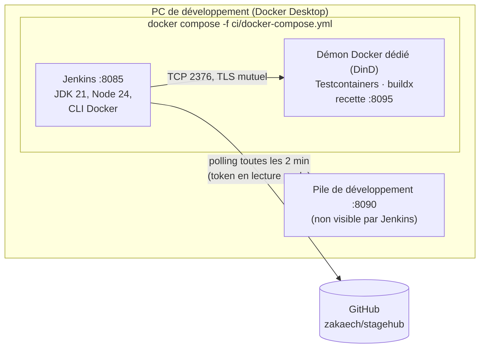
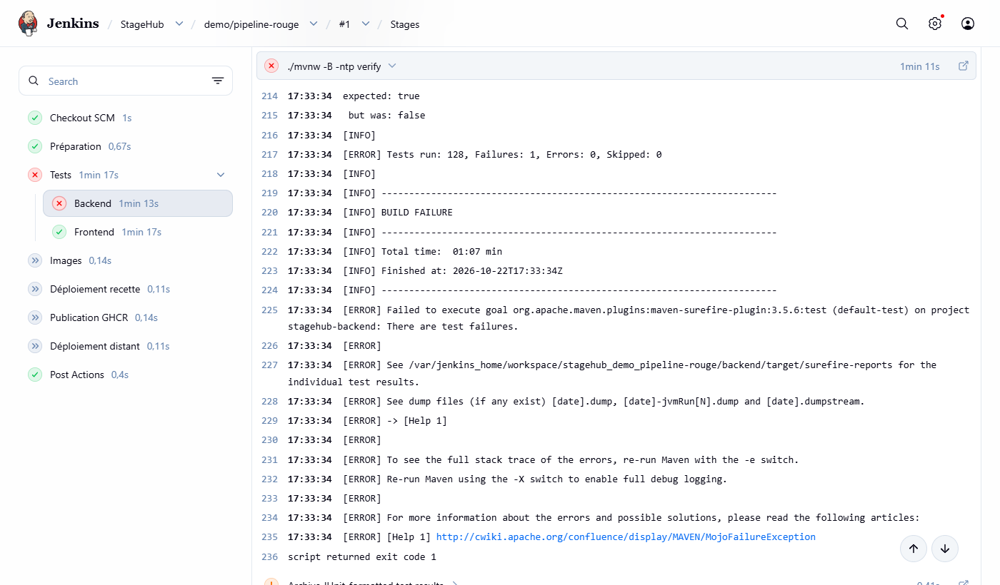
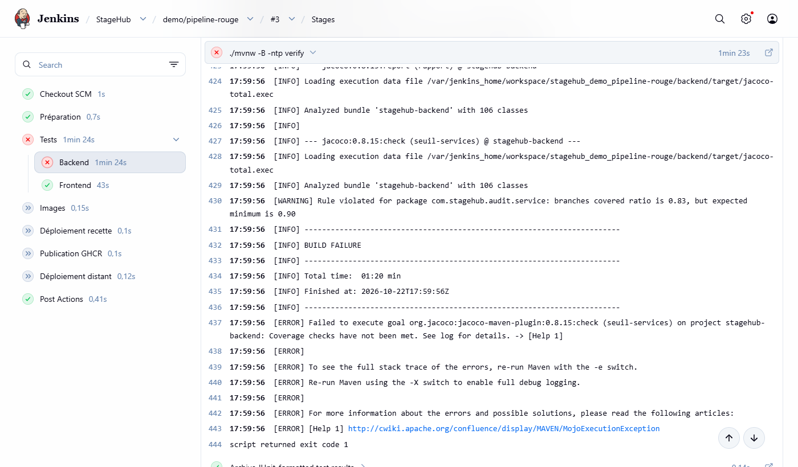

# Intégration continue : Jenkins

Jenkins tourne sur le PC de développement, dans Docker. À chaque commit poussé sur GitHub, il lance pour la branche
concernée : les tests des microservices et du frontend, la construction des images Docker et, sur `main`, le déploiement d'une
application de **recette** (environnement de test proche de la production) sur http://localhost:8095.

| | Adresse |
|---|---|
| Jenkins | http://localhost:8085 (compte `JENKINS_ADMIN_ID` / `JENKINS_ADMIN_PASSWORD` du `.env`) |
| Application de recette (déployée par Jenkins) | http://localhost:8095 · emails : http://localhost:8095/mail/ |

Les deux ports ne sont ouverts que sur `127.0.0.1` : rien n'est visible depuis le réseau local.

---

## Architecture



### Docker-in-Docker plutôt que le socket Docker monté

Monter `/var/run/docker.sock` dans Jenkins revient à lui donner les droits **root** sur le démon Docker de la
machine : n'importe quel code exécuté par un build (script `postinstall` npm, plugin Maven compromis…) pourrait lancer
`docker run --privileged -v /:/host` et lire ou modifier tous les fichiers partagés avec Docker Desktop (dont
`C:\Users`), ou arrêter et supprimer les conteneurs et volumes de développement.

Le pipeline utilise donc un **démon Docker séparé** (conteneur `docker:dind`), joint en TCP avec des certificats
TLS. Il ne voit ni les conteneurs, ni les volumes, ni les fichiers du PC. Limite assumée : ce conteneur tourne en
`privileged` ; ce n'est pas une barrière de sécurité absolue, mais un cloisonnement entre la CI et le poste de travail.

### Polling plutôt que webhook

Jenkins étant sur un PC, GitHub ne peut pas l'appeler. Le job multibranche **interroge GitHub toutes les 2 minutes**
(connexion sortante uniquement). Un tunnel (smee.io, ngrok) donnerait un déclenchement immédiat, mais ferait transiter
le contenu des commits par un service tiers (smee.io) ou exposerait Jenkins sur Internet (ngrok). Avantage
supplémentaire du polling : les commits poussés pendant que le PC est éteint sont rattrapés au démarrage.

---

## Premier lancement

Prérequis : Docker Desktop démarré, `.env` créé à partir de `.env.example` (variables `JENKINS_*` renseignées).

```bash
docker compose -f ci/docker-compose.yml --env-file .env up -d --build
```

Sous Windows (`cmd`), la même commande fonctionne telle quelle. Le premier build de l'image télécharge Jenkins et
ses plugins (quelques minutes). Ouvrir ensuite http://localhost:8085 et se connecter avec le compte du `.env`.

Le job **StageHub** existe déjà : il est créé par la configuration en code (`ci/jenkins/casc.yaml`). Son premier scan
échoue tant que le credential GitHub n'est pas créé (étape suivante).

---

## Credentials

Les secrets ne sont jamais dans le dépôt : ils sont saisis une fois dans Jenkins
(**Administrer Jenkins → Credentials → System → Global credentials → Add Credentials**) et stockés chiffrés dans le
volume `stagehub-ci_jenkins-home`.

| ID | Type | Contenu | Utilisé par |
|---|---|---|---|
| `github-stagehub` | Username with password | Nom d'utilisateur GitHub + token à grain fin en lecture seule | Scan et checkout du dépôt |
| `stagehub-env-recette` | Secret file | `ci/recette.env` | Étape *Déploiement recette* |
| `ghcr-stagehub` | Username with password | Token GitHub (classique) `write:packages` | *Publication GHCR* (désactivée) |
| `oracle-ssh` | SSH Username with private key | Utilisateur + clé privée de déploiement | *Déploiement distant* (désactivé) |
| `oracle-known-hosts` | Secret file | Empreinte SSH du serveur (ligne `known_hosts`) | *Déploiement distant* (désactivé) |
| `oracle-hote` | Secret text | Adresse IP ou nom du serveur | *Déploiement distant* (désactivé) |

### Token GitHub en lecture seule (`github-stagehub`)

1. GitHub → photo de profil → **Settings** → **Developer settings** → **Personal access tokens** →
   **Fine-grained tokens** → **Generate new token**.
2. **Token name** : `jenkins-stagehub-lecture` ; **Resource owner** : `zakaech` ; **Expiration** : **90 days**
   (noter la date affichée).
3. **Repository access** : **Only select repositories** → `zakaech/stagehub`.
4. **Permissions** → **Repository permissions** → **Contents : Read-only** (la permission *Metadata : Read-only* est
   ajoutée d'office). Aucune autre permission.
5. **Generate token**, puis copier le token (il ne sera plus jamais affiché).
6. Dans Jenkins, **Add Credentials** : *Kind* **Username with password**, *Username* `zakaech`, *Password* le token,
   *ID* `github-stagehub`, *Description* `GitHub lecture seule — expire le AAAA-MM-JJ`.
7. Ouvrir le job **StageHub** → **Scan Multibranch Pipeline Now** : la branche `main` apparaît et son premier
   build démarre.

> ⚠️ **Renouvellement tous les 90 jours.** À l'expiration, le scan échoue avec
> `Invalid username or token` et plus aucun build ne se lance. GitHub prévient par email quelques jours avant.
> Pour renouveler : page du token sur GitHub → **Regenerate token** (90 jours), puis dans Jenkins
> **Credentials → github-stagehub → Update** → coller le nouveau token dans *Password* et mettre à jour la date de la
> description.

### Configuration de la recette (`stagehub-env-recette`)

1. Copier `ci/recette.env.example` en `ci/recette.env` (fichier ignoré par git) et remplacer les valeurs `change-me`
   (`JWT_PRIVATE_KEY` : clé RSA d'auth-service, commande dans le fichier).
   **À refaire quand de nouvelles variables apparaissent** (phase 7 : `AUTH_DB_PASSWORD`, `JWT_PRIVATE_KEY`, `NOTIFICATION_DB_PASSWORD`, `OFFRE_DB_PASSWORD`, `CANDIDATURE_DB_PASSWORD`, `AI_DB_PASSWORD`) :
   compléter le fichier puis **Credentials → stagehub-env-recette → Update** pour téléverser la nouvelle version,
   **avant** de pousser le commit qui utilise la variable (sinon l'étape de recette échoue : build n° 8).
2. **Add Credentials** : *Kind* **Secret file**, *File* `ci/recette.env`, *ID* `stagehub-env-recette`.

Jenkins le recopie dans un fichier temporaire pendant l'étape de déploiement seulement
(`withCredentials`), puis le supprime ; son contenu est masqué dans les logs.

---

## Le pipeline (`Jenkinsfile`)

| Étape | Branches | Ce qui se passe | Bloque si… |
|---|---|---|---|
| Préparation | toutes | Sélection de ce qui a changé (`ci/selection.sh`), tag de chaque image = empreinte de son contenu (`ci/tags.sh` → `images.env`), plateformes selon la branche | — |
| Tests › Services | si un module a changé | `services/` : `./mvnw verify` des modules modifiés et de ceux qui en dépendent (`-pl … -amd`), ou de tous (POM parent multi-module) : tests unitaires, tests d'intégration (Testcontainers sur DinD), rapport et **seuils JaCoCo** | un test échoue, ou couverture d'un package `service` < 80 % des lignes / 70 % des branches, service par service |
| Tests › Frontend | si `frontend/` a changé | `npm ci`, Prettier, tests Vitest (rapport JUnit) | formatage incorrect ou test en échec |
| Images | toutes | `docker buildx build` des seules images dont le tag n'existe pas encore (`ci/images.sh`) : **amd64** sur les branches de travail, **amd64 + arm64** sur `main` | un Dockerfile ne se construit pas |
| Déploiement recette | `main` | `docker compose up --wait` sur DinD avec les tags de `images.env` (seuls les services dont l'image a changé sont recréés), puis `demo-seeder` (données de démo par l'API, à travers la gateway) et test de fumée `GET /api/v1/offres` | un service n'atteint pas l'état *healthy*, ou le seeder échoue |
| Publication GHCR | `main` + paramètre | Push des images sur `ghcr.io/zakaech` | (désactivée par défaut) |
| Déploiement distant | `main` + paramètre | SSH sur le serveur : `git pull`, `compose pull`, `up --wait` | (désactivée par défaut) |

Microservices et frontend sont testés **en parallèle**. Dès qu'une étape échoue, les suivantes sont marquées *skipped* :
aucune image n'est construite ni déployée à partir d'un code rouge.

**Rapports publiés dans Jenkins** (page d'un build) :

- **Tests** : résultats JUnit des microservices (Surefire + Failsafe) et du frontend (Vitest), avec l'historique et la
  trace de chaque test en échec ;
- **Couverture services (JaCoCo)** : couverture globale, par package et ligne par ligne dans le code source
  (plugin *Coverage*). Le seuil, lui, est contrôlé par Maven : même règle en local et dans Jenkins.

### Reconstruction sélective (phase 7 f)

Avec huit services, tout retester et tout reconstruire à chaque commit prenait environ 15 minutes (build n° 10 :
tests 8 min 51, images 3 min 50, recette 2 min 34). Le pipeline ne refait plus que ce qui a changé :

- **Tests** : `ci/selection.sh` compare le commit construit à celui du **dernier build réussi** de la branche
  (`GIT_PREVIOUS_SUCCESSFUL_COMMIT`, fourni par le plugin Git). Un module modifié est testé avec ceux qui en dépendent
  (`mvn verify -pl <modules> -amd` : toucher `outbox` reteste offre-service et candidature-service ; toucher `commons`
  reteste presque tout). Un build en échec ne fait pas avancer la référence : ses changements seront retestés.
- **Tout est retesté** si on ne peut pas raisonner sur un diff (premier build d'une branche, historique réécrit) ou si
  un fichier commun change : POM parent, Dockerfile commun, wrapper Maven, `Jenkinsfile`, scripts `ci/*.sh`.
- **Images** : `ci/tags.sh` donne à chaque image un tag égal à l'empreinte de son contenu (arbres git du module, des
  modules internes dont il dépend, du POM parent, du Dockerfile, plus les plateformes). Même contenu → même tag →
  l'image existe déjà dans DinD et n'est pas reconstruite (`ci/images.sh`). La recette ne recrée que les services dont
  le tag a changé.
- **Build complet** : paramètre `COMPLET` (*Build with Parameters*), et chaque jour vers midi sur `main`
  (`cron('H 12 * * *')`). Pas la nuit : Jenkins tourne sur le PC de développement, et un créneau manqué n'est pas
  rattrapé.
- Une modification de la seule documentation ne lance ni test Java ni test Angular : le pipeline reste vert, la
  recette est simplement confirmée.

Les images inutilisées depuis plus de 14 jours sont supprimées de DinD à la fin de chaque build (au pire, une image
supprimée est reconstruite au build suivant).

### Images multi-architecture

Le serveur visé (Oracle Cloud Always Free) est en **ARM (arm64)**. `docker buildx` construit sur `main` une image par
architecture, réunies sous un même tag : chaque machine récupère automatiquement la bonne variante. Dans les
Dockerfiles, les étapes de compilation sont en `FROM --platform=$BUILDPLATFORM` : le jar et le build Angular sont
produits une seule fois, en natif ; seule la petite étape finale (JRE, Nginx) est construite pour arm64 sous émulation
QEMU. Les caches BuildKit (`--mount=type=cache`) évitent de retélécharger les dépendances Maven et npm.

### Activer le déploiement distant (plus tard)

1. Créer les credentials `ghcr-stagehub`, `oracle-ssh`, `oracle-known-hosts`, `oracle-hote` (tableau ci-dessus).
   L'empreinte du serveur s'obtient avec `ssh-keyscan -t ed25519 <IP>` et se **vérifie** avant usage (console Oracle ou
   première connexion manuelle) : c'est elle qui protège contre un faux serveur.
2. Sur le serveur, une seule fois : `docker login ghcr.io` avec un token `read:packages` (images privées).
3. Lancer **Build with Parameters** sur `main` en cochant `DEPLOIEMENT_DISTANT`.

Le `.env` de production reste sur le serveur : aucun secret de production ne passe par Jenkins.

### Vérifier qu'un échec bloque le pipeline

Démonstration faite le 2026-10-22 sur une branche jetable `demo/pipeline-rouge` (supprimée ensuite : Jenkins retire
alors son job au scan suivant) :

| Build | Modification | Résultat |
|---|---|---|
| #1 | Une ligne de `StatutCandidatureTest` inversée (`EN_ATTENTE → ACCEPTEE : true`) | ❌ `Tests run: 128, Failures: 1` ; Frontend vert (parallèle) ; Images *skipped due to earlier failure(s)* |
| #2 | Test rétabli, seuil des **lignes** à 0.99 | ✅ ne bloque pas : chaque package `service` est couvert à **100 % des lignes** |
| #3 | Seuil des **branches** à 0.90 | ❌ `Rule violated for package com.stagehub.audit.service: branches covered ratio is 0.83, but expected minimum is 0.90` alors que tous les tests passent |
| #4 | Seuils rétablis (0.80 / 0.70) | ✅ images amd64 seulement ; recette *skipped due to when conditional* (pas `main`) |

Leçon du build #2 : la couverture globale affichée par Jenkins (≈ 87 % des lignes) inclut controllers et
configuration ; la règle Maven ne porte que sur les packages `service`. Avant de relever un seuil, regarder la
couverture **de ces packages** (rapport HTML JaCoCo ou onglet *Files* de Jenkins).

| Échec d'un test (#1) | Seuil de couverture non atteint (#3) |
|---|---|
|  |  |

---

## Exploitation

```bash
docker compose -f ci/docker-compose.yml --env-file .env stop      # arrêter Jenkins et DinD (tout est conservé)
docker compose -f ci/docker-compose.yml --env-file .env up -d     # relancer
docker compose -f ci/docker-compose.yml --env-file .env up -d --build   # après modification de ci/jenkins/*
```

- ⚠️ `down -v` supprimerait aussi le volume `jenkins-home` : historique des builds **et credentials**.
- **Mettre à jour Jenkins ou un plugin** : changer la version dans `ci/jenkins/Dockerfile` ou `plugins.txt`, puis
  reconstruire. Ne pas mettre à jour depuis l'interface : la modification serait perdue à la reconstruction.
- **Disque de DinD** : `docker exec stagehub-ci-docker docker system df` ; nettoyage du cache de build :
  `docker exec stagehub-ci-docker docker builder prune -f`.
- **Mémoire** : Jenkins est limité à 3 Go (Maven, Testcontainers et npm tournent dedans) et n'exécute qu'un build à
  la fois. Faire tourner en même temps la pile de développement (8090), la recette (8095) et un build est serré
  avec 8 Go alloués à Docker Desktop.

## Dépannage

| Symptôme | Cause probable |
|---|---|
| Scan : `Invalid username or token` | Token GitHub expiré ou credential absent → voir *Renouvellement* |
| `Could not find a valid Docker environment` (Testcontainers) | DinD arrêté : `docker compose -f ci/docker-compose.yml ps` |
| Étape *Déploiement recette* : `Could not find credentials entry with ID 'stagehub-env-recette'` | Credential de recette non créé |
| Build tué sans message (code 137) | Mémoire insuffisante : arrêter la pile de développement ou la recette |
